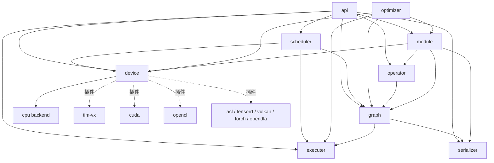

# Tengine 代码结构指南

本文档面向第一次接触 Tengine 代码的开发者，说明目录结构、模块划分、构建架构与常见开发路径。

## 1. 总览

Tengine 是面向嵌入式设备的轻量级深度学习推理框架，核心代码分层如下：

```
用户代码
   │  C API (source/api)
   ▼
图管理 / 图优化 (source/graph, source/optimizer)
   │
   ▼
调度器 / 执行器 (source/scheduler, source/executer)
   │
   ▼
算子前端 (source/operator)          模型解析 (source/serializer)
   │
   ▼
设备后端 (source/device: cpu, tim-vx, cuda, opencl, ...)
```

- **API 层**：`c_api.c` 是所有用户入口的门面，转发到各子系统；
- **图层**：NNIR 计算图（graph/node/tensor/subgraph）与图优化（切图、估算）；
- **调度/执行层**：按 subgraph 调度到不同后端，执行器逐层驱动算子；
- **算子前端**：算子注册框架 + 每个算子的原型实现（infer shape 等）；
- **序列化器**：tmfile 模型格式解析；
- **设备后端**：每个硬件一个 backend，CPU 后端包含参考实现与高性能 kernel。

## 2. 模块地图

| 目录 | 职责 | CMake target | 关键入口 | 依赖 |
|---|---|---|---|---|
| `source/api` | 公开 C API 门面 | `tengine_core_api` | `c_api.c` | 几乎所有模块 |
| `source/graph` | NNIR 图/节点/张量/子图 | `tengine_core_graph` | `graph.c` | executer, serializer |
| `source/executer` | 逐层执行器 | `tengine_core_executer` | `executer.c` | api |
| `source/scheduler` | 图切分与后端调度 | `tengine_core_scheduler` | `scheduler.c` | api, device, graph, executer |
| `source/operator` | 算子注册框架 + 原型 | `tengine_core_operator` | `op.c`, `prototype/` | graph |
| `source/optimizer` | 图优化（切图/估算） | `tengine_core_optimizer` | `split.c` | device, executer, graph, module |
| `source/serializer` | tmfile 模型解析 | `tengine_core_serializer` | `tmfile/tm2_serializer.c` | — |
| `source/module` | 动态模块注册 | `tengine_core_module` | `module.c` | device, graph, operator, serializer |
| `source/system` | CPU 亲和性/系统信息 | `tengine_core_system` | `cpu.c` | — |
| `source/utility` | 日志/内存/向量等基础件 | `tengine_core_utility` | `log.c`, `vector.c` | — |
| `source/device` | 后端聚合 + 注册机制 | `tengine_core_device` | `device.c`, `register.h` | — |
| `source/device/cpu` | CPU 后端（ref + HCL kernel） | `tengine_device_cpu` | `cpu_device.c`, `op/` | — |
| `source/device/{tim-vx,cuda,opencl,...}` | NPU/GPU 插件后端 | 见各自 CMakeLists | `<name>_device.cc` | — |
| `source/olreport` | 可选：在线上报 | `tengine_core_olreport` | — | — |

## 3. 依赖关系图



实线为核心模块编译期依赖，虚线为可选插件后端（由 `TENGINE_ENABLE_*` 开关控制）。

## 4. 目录树注释版

```
Tengine/
├── CMakeLists.txt          # 入口：语言/选项/子目录，选项集中在 cmake/options.cmake
├── cmake/                  # 构建辅助脚本
│   ├── options.cmake       #   全部 TENGINE_* 构建 OPTION（按用途分组）
│   ├── check.cmake         #   编译器/架构/系统探测
│   ├── utility.cmake       #   TENGINE_SOURCE_GROUP / TENGINE_APPLY_TOOLCHAIN_FLAGS
│   ├── summary.cmake       #   配置完成后的信息汇总打印
│   └── libraries/          #   openmp / pthread / syslog 接入
├── source/                 # 核心库源码（每个模块一个 OBJECT target）
├── examples/               # 最小用法示例（分类/检测单模型推理）
├── demos/                  # 完整应用（摄像头/多模型 pipeline，依赖 OpenCV）
├── tools/                  # 开发者工具
│   ├── convert_tool/       #   其他框架模型 → tmfile 转换
│   ├── quantize/           #   int8/uint8 量化
│   └── optimize/ save_graph/ align_tool/
├── benchmark/              # 性能评估（tm_benchmark）
├── tests/                  # 单元/集成测试（onnx op 对齐测试、模型测试）
├── pytengine/              # Python 绑定
├── toolchains/             # 交叉编译工具链文件
├── third_party/            # 外部依赖与测试数据（git submodule）
└── doc/                    # 中英文文档（本文件所在位置）
```

## 5. CMake 选项速查表

完整定义见 [cmake/options.cmake](../../cmake/options.cmake)，按分组：

| 分组 | 选项（默认值） | 说明 |
|---|---|---|
| 构建开关 | `TENGINE_BUILD_BENCHMARK(ON)` `TENGINE_BUILD_EXAMPLES(ON)` `TENGINE_BUILD_DEMO(OFF)` `TENGINE_BUILD_TESTS(OFF)` `TENGINE_BUILD_CPP_API(OFF)` | 控制顶层子目录是否参与构建 |
| 工具 | `TENGINE_BUILD_CONVERT_TOOL(OFF)` `TENGINE_BUILD_QUANT_TOOL(OFF)` | 模型转换/量化工具 |
| 多线程 | `TENGINE_OPENMP(ON)` | OpenMP 并行 |
| 高性能算子 | `TENGINE_ARCH_X86_AVX(ON)` `TENGINE_ARCH_ARM_82(OFF)` `TENGINE_STANDALONE_HCL(OFF)` | x86 AVX2 / ARM v8.2 kernel，HCL 独立库 |
| 后端插件 | `TENGINE_ENABLE_TIM_VX/CUDA/OPENCL/ACL/TENSORRT/VULKAN/TORCH/OPENDLA/NNIE(均 OFF)` | 硬件后端接入 |
| 调试 | `TENGINE_DEBUG_DATA/TIME/MEM_STAT(OFF)` `TENGINE_ENABLE_ALL_SYMBOL(OFF)` | 逐层数据/耗时导出，符号可见性 |
| 其他 | `TENGINE_ENABLE_MODEL_CACHE(OFF)` `TENGINE_ONLINE_REPORT(ON)` | NPU cache、在线上报 |

## 6. 构建架构（2026-10 重构后）

```
tengine_core_<module> (OBJECT lib, 每个模块一个)
        │  $<TARGET_OBJECTS:...>
        ▼
tengine-lite-static (STATIC)  ──  tengine-lite (SHARED)
        ▲                             ▲
        └── 后端插件源码（tim-vx/cuda/...，迁移中，仍走变量注入）
```

- `cmake/options.cmake`：全部 OPTION 集中管理；
- `tengine_build_config`（INTERFACE）：公共宏、编译/链接选项，模块 PRIVATE 引用，不外泄给消费者；
- `tengine_public_include`（INTERFACE）：统一头文件搜索路径；
- 旧的全局变量（`TENGINE_*_SOURCE` 等）仍保留导出，兼容未迁移的后端插件与 standalone HCL 构建；
- 新增模块的标准动作：建目录 → 写 CMakeLists（OBJECT target + 链接两个 INTERFACE target）→ 在 `source/CMakeLists.txt` 注册到 `TENGINE_OBJECT_TARGETS`。

## 7. 数据流

1. **加载**：`create_graph` 读入 tmfile → `serializer/tmfile` 解析出算子与权重；
2. **建图**：`graph/` 构建 NNIR（node/tensor/subgraph）；
3. **优化**：`optimizer/` 按后端能力切分子图（CPU 子图、NPU 子图）；
4. **调度**：`scheduler/` 把子图分发到对应 device 后端并注册执行环境；
5. **执行**：`executer/` 逐层调用算子前端 → CPU 算子走 `device/cpu/op/`（ref 或 HCL kernel），NPU 子图整体下发（如 TIM-VX）。

## 8. 常见开发路径

### 新增/修改一个 CPU 算子

1. `source/operator/prototype/<op>/<op>.c`：算子注册与 infer shape（同名目录已存在则改）；
2. `source/device/cpu/op/<op>/<op>_ref.c`：参考实现（必须）；
3. 可选：`cortex-a/`（NEON）、`x86/`（AVX）目录加高性能 kernel，`*_hcl_*.c` 负责注册；
4. `source/serializer/tmfile/op/<op>.c`：tmfile 参数解析（新算子需要）；
5. 重新配置构建即可（op 目录为插件式，GLOB 带CONFIGURE_DEPENDS 自动纳管）。

### 新增一个硬件后端

1. 新建 `source/device/<name>/`，参考 `tim-vx/` 骨架：CMakeLists.txt + `<name>_device.cc` + op 实现；
2. `cmake/options.cmake` 增加 `TENGINE_ENABLE_<NAME>` OPTION；
3. `source/device/CMakeLists.txt` 增加 `IF (TENGINE_ENABLE_<NAME>)` 块：ADD_SUBDIRECTORY + 合并变量 + 追加 `TENGINE_ENABLE_<NAME>` 宏；
4. `source/device/register.h` 增加注册声明；
5. `examples/`/`tests/` 按需增加示例与测试。

### 常用构建命令

```bash
# 默认构建（benchmark + examples）
cmake -B build && cmake --build build -j`nproc`

# 带测试
cmake -B build -DTENGINE_BUILD_TESTS=ON && cmake --build build -j`nproc` && ctest --test-dir build

# 模型转换工具
cmake -B build -DTENGINE_BUILD_CONVERT_TOOL=ON && cmake --build build -j`nproc`

# TIM-VX NPU（需先准备 TIM-VX SDK，见 doc/docs_zh/source_compile/compile_timvx.md）
cmake -B build -DTENGINE_ENABLE_TIM_VX=ON -DTIM_VX_INSTALL=<路径> && cmake --build build -j`nproc`

# 安装
cmake --install build --prefix ./install   # 产物：lib/ + include/tengine/
```

## 9. 顶层目录职责约定

| 目录 | 定位 | 判定标准 |
|---|---|---|
| `examples/` | 单模型最小示例 | 一两百行内讲清 API 用法 |
| `demos/` | 完整应用 | 多模型/摄像头/预处理后处理完整链路 |
| `tools/` | 开发者工具链 | 离线使用，不依赖推理运行时以外的业务逻辑 |
| `benchmark/` | 性能测试 | 标准网络的速度/带宽数据 |
| `tests/` | 正确性测试 | ctest 可执行、可对齐 ONNX 结果 |
